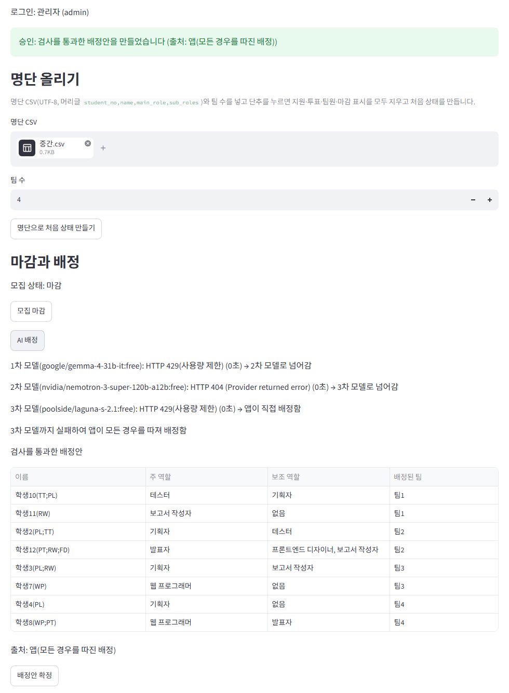
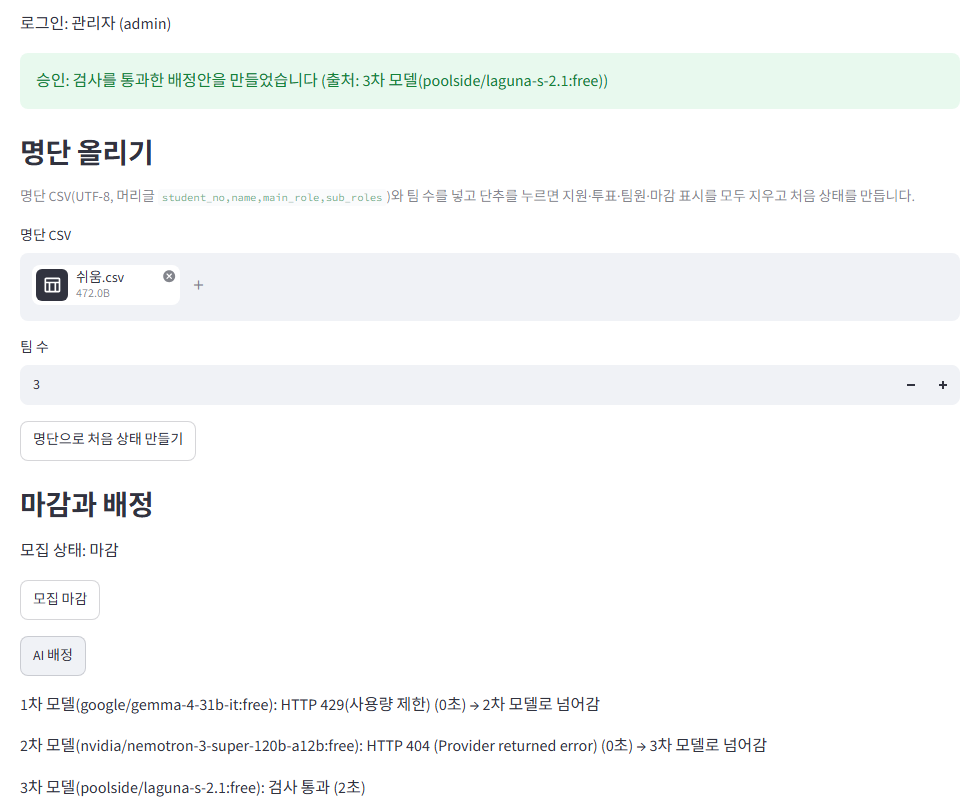
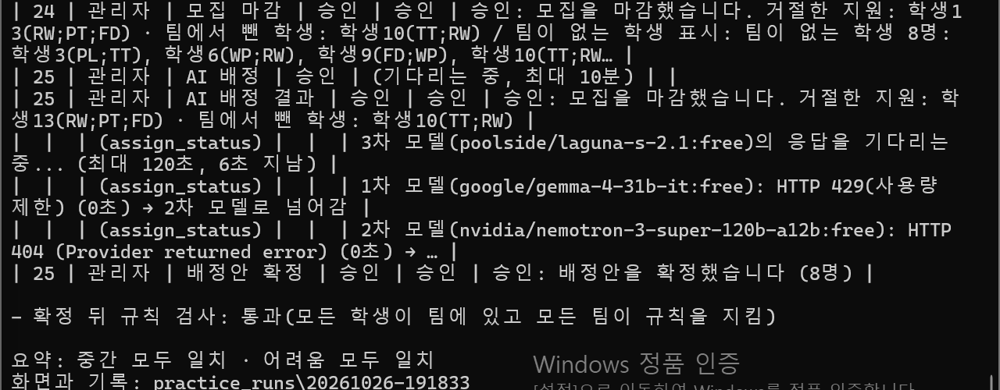
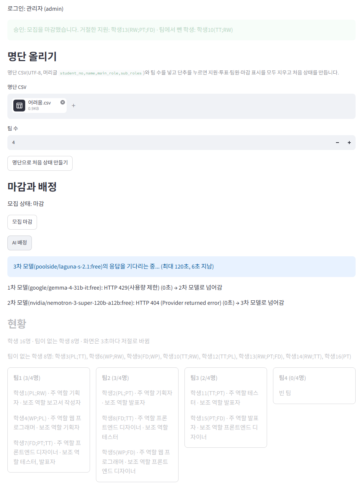

# 팀 프로젝트 팀 편성 웹 앱

데이터프로젝트 중간고사 대체과제. 학생이 팀에 지원하고 팀원이 투표해 팀을 만들고, 모집을 마감한 뒤 남은 학생은 AI가 배정하는 Streamlit 앱이다.

## 1. 배포 주소

https://team-formation-hdbpx5ugjy3xnu6w9w8gok.streamlit.app

## 2. PRD와 구현 계획

- PRD: [docs/PRD.md](docs/PRD.md)
- 구현 계획: [docs/구현 계획.md](docs/구현%20계획.md)

## 3. 고른 해결 방법 (공고 3장)

모든 기능에서 어려운 해결을 골랐다. 자세한 내용은 PRD 9장에 있다.

| 기능 | 고른 해결 | 만든 방법 |
|---|---|---|
| 다른 사람의 변경 보기 | 어려운 해결 | `st.fragment(run_every=3)`로 바뀐 부분만 3초마다 다시 그림 |
| 필수 포함 역할을 지킬 수 없는 팀 | 어려운 해결 | 지원 단계에서 필수 포함 역할 자리를 계산해, 자리가 모자라게 되는 지원을 막음 |
| 같은 팀에 대기 중인 지원이 여럿 | 어려운 해결 | 승인 직전에 규칙을 다시 검사하고, 투표가 끝난 순서로 처리 |
| 마지막 자리에 두 명이 동시에 들어감 | 어려운 해결 | `tf_members`의 유일성 제약(`schema.sql`)과 쓰기 잠금(`pg_advisory_xact_lock`)으로 먼저 도착한 학생만 기록 |
| AI 응답이 늦을 때 | 어려운 해결 | 모델마다 120초의 전체 대기 시간을 재서 끊고 다음 모델로 넘어감 |
| 3차 모델까지 실패 | 어려운 해결 | 다섯 가지 검사를 모두 통과하는 배정을 모든 경우를 따져 끝까지 찾음 |
| AI 대기 중 화면 | 어려운 해결 | `assign_status`에 몇 차 모델의 응답을 기다리는지와 지난 시간을 보여 줌 |
| DB(Supabase)가 일시정지되지 않게 | 어려운 해결 | GitHub Actions 예약 작업(`.github/workflows/keep-alive.yml`)이 매일 DB에 질의를 보냄 |

## 4. 쓴 모델 3개

- 1차 `google/gemma-4-31b-it:free`
- 2차 `nvidia/nemotron-3-super-120b-a12b:free`
- 3차 `poolside/laguna-s-2.1:free`

## 5. 오픈라우터 AI 모델 호출 실패 사례

2026-10-26 배포한 앱에서 부록의 연습용 시나리오 3개를 실행하며 본 화면이다.

1. **세 모델이 모두 실패해 앱이 직접 배정함** (부록 2 중간, 11단계)
   - 1차 모델: HTTP 429(사용량 제한)
   - 2차 모델: HTTP 404 (Provider returned error)
   - 3차 모델: HTTP 429(사용량 제한)
   - 결과: 앱이 모든 경우를 따져 배정안을 만들었다("출처: 앱(모든 경우를 따진 배정)"). 8명을 배정했고, 확정 뒤 규칙 검사도 통과했다.
   - 화면: [img/ai-medium-step11.png](img/ai-medium-step11.png)

   

2. **1차·2차 모델이 실패하고 3차 모델의 배정안이 검사를 통과함** (부록 1 쉬움, 6단계)
   - 1차 모델: HTTP 429(사용량 제한)
   - 2차 모델: HTTP 404
   - 3차 모델: 응답과 검사까지 2초 걸렸고("검사 통과 (2초)"), 그 배정안이 다섯 가지 검사를 통과했다("출처: 3차 모델(poolside/laguna-s-2.1:free)").
   - 화면: [img/ai-easy-step6.png](img/ai-easy-step6.png)

   

## 6. 클로드가 잘못 추론하거나 답한 사례

1. **연습 도구가 AI 배정 결과를 기다리지 않고 지난 결과를 적음**
   - 무엇이 잘못됐나: 클로드가 만든 연습 시나리오 자동 실행 도구(`scripts/e2e_practice.py`)에 문제가 있었다. 도구는 단추를 누른 뒤 결과 안내가 8초 동안 바뀌지 않으면, 앞 결과와 문구가 같은 경우로 보고 그대로 읽었다. 그런데 AI 배정 중에는 지난 결과(모집 마감)가 그대로 보인다. 그래서 도구가 모집 마감 문구를 AI 배정 결과로 적었다.
   - 알아챈 방법: 부록 3(어려움) 15단계(도구 표에서는 25번 줄)의 실행 결과표를 보고 알아챘다. "AI 배정 결과" 줄이 "승인: 모집을 마감했습니다…"였고, 바로 아래 `assign_status`는 "3차 모델(poolside/laguna-s-2.1:free)의 응답을 기다리는 중... (최대 120초, 6초 지남)"이었다. 화면은 [img/practice-tool-hard-step15.png](img/practice-tool-hard-step15.png)이다.
   - 고친 것: AI 배정 단계는 결과 문구가 바뀔 때까지 기다리게 했다(`same_ok=False`). 이 실행 기록을 보고 고쳤고, 고친 코드는 커밋 `6c45393`에 들어 있다.

   

2. **명단을 다시 올리면 학생 id를 1부터 다시 매김**
   - 무엇이 잘못됐나: 클로드가 과제 5(쓰기 처리)에서 만든 테스트용 저장소(`tests/memory_repo.py`)와 테스트는 명단을 다시 올리면 학생 id를 1부터 다시 매겼다(테스트 주석 "다시 올려도 1부터"). 그런데 화면 계획(과제 8)은 로그인한 학생을 id로 기억하게 되어 있었다. 그대로 만들었다면 명단을 다시 올린 뒤, 예전 브라우저 창이 비밀번호를 넣지 않고도 새 명단의 다른 학생 계정이 될 수 있었다.
   - 알아챈 방법: 구현 계획의 과제마다 코드 검토를 받았는데, 과제 5 검토에서 화면 계획(과제 8)과 함께 보다가 지적됐다.
   - 고친 커밋: `ca51b90` "fix: 명단을 다시 올려도 학생 id를 다시 쓰지 않음". 그 뒤 화면에서는 세션에 학번도 함께 저장해, DB의 계정과 같은 사람인지 확인한다.

3. **결과 안내가 네 단어로 시작하지 않거나 3초마다 비워짐**
   - 무엇이 잘못됐나: 클로드가 처음 만든 화면(과제 8)의 결과 안내(`result`)에는 문제가 두 가지 있었다.
     - 관리자 화면에서 AI 배정을 기다리는 동안 `result`에 "AI 배정 중... 끝나면 결과가 여기에 나옴"을 보여 줬다. 공고 2.7절은 `result`가 승인·대기·거절·막힘 가운데 하나로 시작해야 한다고 한다.
     - `result` 안을 `st.empty()` 자리로 만들어, 화면을 다시 그릴 때마다 결과 안내가 잠깐 비워졌다. 학생 화면은 3초마다 다시 그리므로 3초마다 비워졌고, 채점 프로그램이 빈 결과를 읽을 수 있었다.
   - 알아챈 방법: 과제 8(화면) 코드 검토에서 지적됐다.
   - 고친 커밋: `55e838c` "fix: 결과 안내가 비워지지 않게, AI 배정 중 문구 제거, 관리자 화면 테스트"

## 7. 앱에서 발견한 문제점과 개선할 점

배포한 앱에서 연습용 시나리오 3개를 연습 도구(`scripts/e2e_practice.py`)로 끝까지 실행했다. 어려움 15단계의 AI 배정 결과 문구는 도구가 지난 결과를 읽는 바람에 확인하지 못했다(6항 1번). 나머지 단계는 결과 안내의 첫 단어가 기대 결과와 같았고, 세 시나리오 모두 확정 뒤 규칙 검사를 통과했다. 그래도 아래 문제를 찾았다.

1. **AI 배정을 기다리는 동안 결과 안내에 지난 결과가 그대로 보임** (부록 3 어려움, 15단계)
   - 본 것: "AI 배정"을 누른 뒤 3차 모델의 응답을 기다렸다(화면은 3차 모델에 요청하고 6초가 지난 때). 그동안 결과 안내(`result`)에는 앞 단계의 "승인: 모집을 마감했습니다…"가 흐리게 남아 있었고, 현황도 흐려졌다. AI 배정 결과로 착각하기 쉽다. 실제로 연습 도구도 이 문구를 AI 배정 결과로 잘못 적었다(6항 1번).
   - 화면: [img/hard-step15-ai-wait.png](img/hard-step15-ai-wait.png)
   - 원인: `result`에는 승인·대기·거절·막힘으로 시작하는 문구만 넣기로 했다(공고 2.7절). 그래서 `result`는 AI 배정이 끝난 뒤에만 채우고, 기다리는 동안의 진행 상황은 `assign_status`에만 보여 준다.
   - 개선할 점: 기다리는 동안 보이는 `result`가 지난 결과임을 알 수 있어야 한다. 예를 들어 기다리는 동안 `assign_status` 맨 위에 "위 결과 안내는 앞 단계의 결과이며, AI 배정 결과는 끝나면 나옴"을 보여 준다. 이번 제출에서는 채점 화면 동작을 바꾸지 않으려고 고치지 않았다.

   

2. **2차 모델이 연습 실행 세 번 모두 HTTP 404로 실패함** (부록 1 쉬움 6단계, 부록 2 중간 11단계, 부록 3 어려움 15단계)
   - 본 것: 2차 모델 `nvidia/nemotron-3-super-120b-a12b:free`가 세 번 모두 "HTTP 404 (Provider returned error)"로 0초 만에 실패했다.
   - 화면: 5항의 [img/ai-medium-step11.png](img/ai-medium-step11.png)와 [img/ai-easy-step6.png](img/ai-easy-step6.png), 7항 1번의 화면
   - 영향: 3차 모델과 앱의 직접 배정이 받쳐 줘서 결과는 맞았다. 하지만 AI 모델은 사실상 2개만 쓰는 셈이다.
   - 개선할 점: 오픈라우터에서 응답하는 다른 무료 모델로 바꾸고, PRD 8.1절의 모델 목록도 함께 고쳐야 한다.

---

작성자: 김송연
